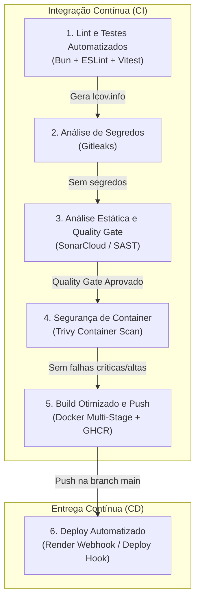
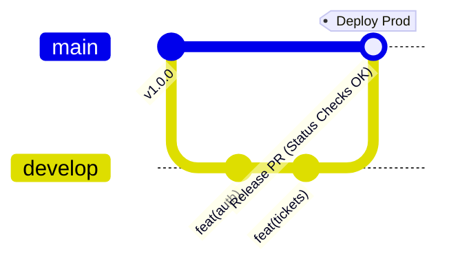

# Documentação Técnica de Infraestrutura e DevOps

Este documento apresenta o relatório técnico da arquitetura de DevOps, engenharia de confiabilidade e infraestrutura contínua da **Help Desk API**.

O projeto adota princípios de **Shift-Left Security**, **Artefatos Imutáveis** (*Immutable Artifacts*) e esteiras de entrega contínua com portas de qualidade (*Quality Gates*) estritas.

---

## 1. Arquitetura da Pipeline de CI/CD

A esteira de integração e entrega contínua é implementada no **GitHub Actions** (`.github/workflows/ci-cd.yml`). Ela foi desenhada com dependências sequenciais rígidas: a falha em qualquer etapa de segurança ou qualidade interrompe o avanço para as etapas subsequentes, impedindo a geração ou o deploy de imagens defeituosas.



### Detalhamento Sequencial dos Estágios:

1. **`lint-and-tests` (Padronização e Regras de Negócio):**
   * Valida a conformidade de estilo com ESLint.
   * Executa a suíte de testes unitários e de integração com cobertura v8 do Vitest, exigindo limite mínimo de 70% (atualmente com cobertura efetiva de ~84%).
   * Exporta o artefato de cobertura `coverage/lcov.info`.

2. **`secret-scanning` (Detecção Estática de Credenciais):**
   * Executa varredura profunda com [Gitleaks](https://github.com/gitleaks/gitleaks-action) sobre o histórico e diffs de commits.
   * Garante que nenhum token JWT, chave de API de terceiros (Cloudinary), senha de SMTP ou segredo de banco de dados tenha sido acidentalmente versionado.

3. **`sonar-quality-gate` (SAST e Auditoria de Qualidade de Código):**
   * Conecta ao SonarCloud através do `sonar-project.properties`.
   * Cruza a análise estática do código-fonte (`src/`) com o relatório de cobertura importado (`coverage/lcov.info`).
   * **Critério de Parada:** Bloqueia a esteira caso o Quality Gate seja reprovado por vulnerabilidades de segurança, *security hotspots* abertos, bugs ou índice de cobertura inferior ao contratado.

4. **`container-security` (Inspeção de Vulnerabilidades em Imagem):**
   * Constrói uma imagem temporária local e a submete à análise de vulnerabilidades conhecidas (CVEs) com [Trivy](https://github.com/aquasecurity/trivy-action).
   * Inspeciona tanto os pacotes do sistema operacional base (`debian`) quanto os pacotes de runtime instalados em busca de vulnerabilidades com severidade `CRITICAL` e `HIGH`.

5. **`build-and-push` (Compilação Multi-Stage e Publicação de Artefato):**
   * Utiliza Docker Buildx com cache nativo do GitHub Actions (`type=gha`).
   * Publica a imagem tagueada (com a tag `latest` e a SHA única do commit) no registro oficial do GitHub Container Registry (`ghcr.io/thawanvcsantos/helpdesk-api`).
   * A imagem publicada constitui o **artefato único e imutável** que será executado em produção.

6. **`deploy-render` (Acionamento Automatizado em Produção):**
   * Condicionado estritamente a commits mesclados na branch de produção (`main`).
   * Dispara um webhook autenticado via HTTP POST para o *Deploy Hook* do Render, instruindo o orquestrador a atualizar a instância para o novo artefato do registro.

---

## 2. Decisões de Segurança e Confiabilidade

### 2.1. Princípio de Artefatos Imutáveis (*Immutable Infrastructure*)
A infraestrutura em nuvem (Render) não compila código, não executa etapas de compilação ou instalação de pacotes a partir do código-fonte. O ambiente consome exclusivamente a imagem Docker pré-construída, escaneada e assinada pelo pipeline no GitHub Container Registry (`ghcr.io`). Isso garante paridade total entre o ambiente validado pelos testes e o ambiente em execução em produção.

### 2.2. Menor Privilégio no Container (*Least Privilege*)
Diferente da prática padrão de rodar containers com o usuário `root`, a imagem final em tempo de execução opera sob a instrução:
```dockerfile
USER bun
```
O processo da aplicação é restrito a um usuário sem privilégios de superusuário no sistema operacional do container, mitigando vetores de ataque baseados em fuga de container (*container escape*) em caso de exploração de vulnerabilidades da camada de aplicação.

### 2.3. Multi-Stage Build Otimizado
O [`Dockerfile`](./Dockerfile) é estruturado em estágios isolados para minimizar o vetor de ataque e a pegada de memória da imagem:
* **Estágios de Build (`dependencies`, `builder`, `production-dependencies`):** Contêm compiladores, bibliotecas de compilação e dependências de desenvolvimento.
* **Estágio de Runtime (`runtime`):** Carrega exclusivamente os arquivos estritamente necessários para a execução (código-fonte, node_modules de produção e schema Prisma), descartando caches e ferramentas de desenvolvimento.

### 2.4. Gestão de Segredos e Isolamento de Credenciais
* Nenhum dado sensível ou variável de ambiente com credenciais é persistido no repositório Git ou incorporado nas camadas da imagem Docker (`ARG` ou `ENV`).
* Variáveis de ambiente (`DATABASE_HOST`, `DATABASE_PASSWORD`, `JWT_SECRET`, tokens de mensageria) são injetadas estritamente em tempo de execução pelo provedor de hospedagem e pelo Docker Compose local.
* Senhas de usuários utilizam criptografia derivativa de alta resistência via algoritmo **Argon2id**, e tokens de recuperação de conta são persistidos exclusivamente sob hash unidirecional.

---

## 3. Funcionamento do Quality Gate (SonarQube / SonarCloud)

O Quality Gate atua como um controle obrigatório de integridade arquitetural e de código. A integração é orientada pelas diretivas definidas em [`sonar-project.properties`](./sonar-project.properties).

### Critérios de Aceite Obrigatórios:
* **Cobertura de Código:** Exigência de cobertura mínima de 70% sobre código novo e legado, aferida pelo relatório LCOV (`coverage/lcov.info`).
* **Vulnerabilidades e Segurança (Security Rating):** Nenhuma vulnerabilidade de nível crítico ou alto tolerada (Rating A). Hotspots de segurança devem ser categorizados e aprovados.
* **Confiabilidade (Reliability Rating):** Zero bugs bloqueantes (*Blocker Bugs*) ou críticos.
* **Manutenibilidade (Maintainability Rating):** Baixa densidade de *code smells* e duplicação de código controlada.

Caso qualquer um desses limiares seja violado, o SonarCloud reporta a falha via API ao GitHub Actions, que cancela a esteira antes que a imagem seja gerada para distribuição.

---

## 4. Fluxo de Branches e Política de Proteção (*Branching Strategy*)

A governança do repositório adota o modelo **GitHub Flow** combinado com **Rulesets de Proteção**:



### Diretrizes de Branches:
* **`main` (Ambiente de Produção):**
  * Branch estável. Qualquer atualização na `main` dispara o pipeline completo de CI e CD, resultando no deploy automatizado no Render.
  * **Regras de Proteção ativas (Ruleset):**
    * Bloqueio obrigatório de *force push* (`Block force pushes`).
    * Proibição de exclusão da branch (`Restrict deletions`).
    * Exigência de integração via Pull Request (`Require a pull request before merging`).
    * Exigência de aprovação compulsória nos status checks: os jobs `1. Lint e Testes` e `3. Análise de Qualidade (SonarQube)` devem estar em estado de sucesso para autorizar o merge.
    * Exigência de branch de origem atualizada com a branch de destino (`Require branches to be up to date before merging`).
* **`develop` ou `feature/*` (Ambientes de Desenvolvimento / Feature Branches):**
  * Destinadas à evolução incremental de código.
  * A abertura de Pull Requests ou commits nessas branches executa os estágios 1 a 5 da pipeline (Lint, Testes, Gitleaks, SonarQube e Container Scan), garantindo validação prévia sem impacto no ambiente de produção.

---

## 5. Orquestração e Inicialização do Banco de Dados

A arquitetura adota estratégias complementares para a execução de migrations e seeds, respeitando as particularidades de cada ambiente:

### 5.1. Ambiente Local (Docker Compose)
No ambiente de desenvolvimento local (`docker-compose.yml`), a orquestração aproveita o estágio dedicado **`migrator`** do multi-stage build:
* O serviço `migrate` sobe isolado, aguarda a saúde do container do PostgreSQL (`condition: service_healthy`), executa `bunx prisma migrate deploy` e `bunx prisma db seed`, e é encerrado com código de saída 0.
* O serviço `api` (estágio `runtime`) depende estritamente do sucesso prévio do migrator (`condition: service_completed_successfully`), garantindo separação limpa de responsabilidades entre tarefas de migração e o servidor HTTP.

### 5.2. Ambiente de Produção em Nuvem (Render)
Em plataformas PaaS em nuvem sem suporte a orquestração multi-container no plano gratuito, a inicialização é coordenada de forma autônoma e segura pelo script de entrada do container ([`scripts/start.sh`](./scripts/start.sh)):
```bash
#!/bin/sh
set -e
bun run db:deploy
bun run db:seed
exec bun run start
```
* **`bun run db:deploy` (`prisma migrate deploy`):** Avalia o PostgreSQL gerenciado do Render e aplica migrations pendentes de forma atômica e idempotente.
* **`bun run db:seed` (`prisma db seed`):** Executa rotinas idempotentes de carga inicial (criação de roles `USER`, `AGENT`, `ADMIN`, categorias padrão e provisionamento do administrador do sistema caso inexistente).
* **`bun run start` (`bun src/index.js`):** Inicializa o servidor HTTP na porta parametrizada após a confirmação do estado íntegro do schema e dos dados essenciais.
* **Monitoramento Contínuo:** O endpoint `/health` é sondado periodicamente pelo mecanismo de health check da infraestrutura para validação de integridade operacional.
