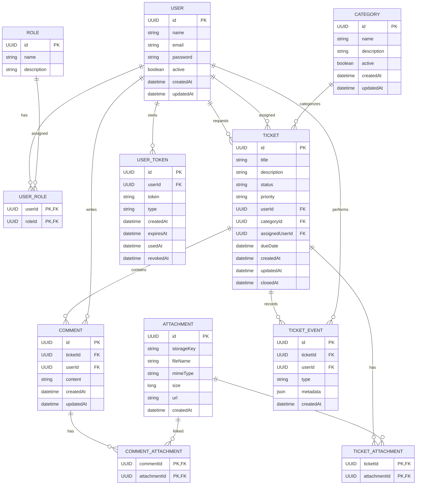

# Help Desk API

## Sobre o projeto

O **Help Desk API** é uma API REST para gerenciamento de chamados de suporte de TI.

O sistema permite que usuários previamente cadastrados pela administração registrem chamados, acompanhem seu andamento, adicionem comentários e anexos, enquanto usuários com permissões administrativas ou de atendimento podem gerenciar categorias, atribuir responsáveis e atualizar informações dos chamados.

## Objetivo

O objetivo do sistema é centralizar o atendimento de solicitações de suporte de TI, permitindo:

- abertura e acompanhamento de chamados;
- classificação por categoria e prioridade;
- atribuição de responsáveis;
- atualização do status dos chamados;
- comunicação por meio de comentários;
- inclusão de arquivos e anexos;
- registro do histórico de alterações;
- notificações relacionadas aos chamados;
- controle de acesso por perfis;
- ativação de usuários e definição inicial de senha por e-mail;
- recuperação de senha por e-mail.

## Escopo

O sistema terá como entidade central o **Ticket (chamado)**.

A partir dele, outras entidades estarão relacionadas para representar o processo de atendimento:

- usuários que solicitam ou atendem chamados;
- categorias utilizadas para classificar os chamados;
- comentários realizados durante o atendimento;
- anexos relacionados a chamados e comentários;
- eventos que registram ações relevantes realizadas nos chamados;
- tokens utilizados nos processos de ativação de usuários, definição inicial de senha e recuperação de senha.

Funcionalidades adicionais, como notificações e acompanhamento de chamados, poderão ser incorporadas conforme a evolução do projeto.

## Perfis de usuário

### Usuário comum

Pode:

- autenticar-se no sistema;
- criar chamados;
- visualizar seus próprios chamados;
- acompanhar o andamento dos chamados;
- adicionar comentários;
- adicionar anexos;
- atualizar informações permitidas de seus chamados;
- definir a senha inicial por meio do convite enviado pelo sistema;
- utilizar o processo de recuperação de senha.

### Agente

Representa um usuário autorizado a atuar no atendimento dos chamados.

Pode, conforme as regras de autorização definidas:

- visualizar chamados destinados ao atendimento;
- assumir ou receber chamados;
- alterar status;
- alterar prioridade;
- adicionar comentários;
- adicionar anexos;
- acompanhar o histórico dos chamados.

### Administrador

Possui permissões administrativas adicionais, como:

- gerenciar usuários;
- ativar ou desativar usuários;
- gerenciar categorias;
- administrar chamados;
- atribuir responsáveis;
- consultar informações administrativas;
- executar operações restritas aos administradores.

Um mesmo usuário poderá possuir mais de um papel.

## Entidades

### User

Representa os usuários do sistema.

Principais atributos:

- `id` — UUID
- `name`
- `email`
- `password`
Senha do usuário. Deve ser armazenada utilizando hash seguro,
  nunca em texto puro.
- `active`
- `createdAt`
- `updatedAt`

Usuários desativados não poderão realizar autenticação, mas seus registros serão mantidos para preservar o histórico do sistema.

Não haverá cadastro público de usuários. Novos usuários serão criados por administradores e receberão um token temporário por e-mail para realizar a ativação e definir a senha inicial.

O primeiro administrador será criado por meio de um seed durante a inicialização do ambiente.

### Role

Representa um papel de acesso do sistema.

Principais atributos:

- `id` — UUID
- `name`
- `description`

Papéis inicialmente previstos:

- `USER`
- `AGENT`
- `ADMIN`

### UserRole

Tabela de relacionamento entre usuários e papéis.

Atributos:

- `userId` — UUID
- `roleId` — UUID

A combinação `userId + roleId` deverá ser única.

### Ticket

Representa um chamado de suporte.

Principais atributos:

- `id` — UUID
- `title`
- `description`
- `status`
- `priority`
- `userId` — usuário solicitante
- `categoryId`
- `assignedUserId` — responsável pelo atendimento, quando houver
- `dueDate` — prazo previsto para atendimento
- `createdAt`
- `updatedAt`
- `closedAt`

Status inicialmente previstos:

- `OPEN`
- `IN_PROGRESS`
- `WAITING_USER`
- `RESOLVED`
- `CLOSED`

Prioridades inicialmente previstas:

- `LOW`
- `MEDIUM`
- `HIGH`
- `CRITICAL`

### Category

Representa a categoria de um chamado.

Principais atributos:

- `id` — UUID
- `name`
- `description`
- `active`
- `createdAt`
- `updatedAt`

Categorias inativas não deverão ser utilizadas na abertura de novos chamados.

### Comment

Representa uma mensagem adicionada a um chamado.

Principais atributos:

- `id` — UUID
- `ticketId`
- `userId`
- `content`
- `createdAt`
- `updatedAt`

### Attachment

Representa um arquivo armazenado pelo sistema.

Principais atributos:

- `id` — UUID
- `storageKey`
- `fileName`
- `mimeType`
- `size`
- `url`
- `createdAt`

### TicketAttachment

Relaciona arquivos aos chamados.

Atributos:

- `ticketId` — UUID
- `attachmentId` — UUID

### CommentAttachment

Relaciona arquivos aos comentários.

Atributos:

- `commentId` — UUID
- `attachmentId` — UUID

### TicketEvent

Representa eventos relevantes ocorridos em um chamado.

Principais atributos:

- `id` — UUID
- `ticketId` — UUID
- `userId` — UUID
- `type`
- `metadata`
- `createdAt`

Tipos inicialmente previstos:

- `CREATED`
- `STATUS_CHANGED`
- `PRIORITY_CHANGED`
- `ASSIGNED`
- `UNASSIGNED`
- `COMMENT_ADDED`
- `ATTACHMENT_ADDED`
- `CATEGORY_CHANGED`
- `DUE_DATE_CHANGED`

O histórico deverá registrar ações relevantes para acompanhamento do chamado, não simplesmente qualquer alteração interna realizada no banco.

O campo `metadata` poderá armazenar informações complementares da alteração, como valor anterior e novo valor.

### UserToken

Representa tokens temporários relacionados a processos de segurança do usuário.

Principais atributos:

- `id` — UUID
- `userId` — UUID
- `token`
  Token utilizado para ativação ou recuperação de senha.
  Deve ser armazenado de forma segura, como hash.
- `type`
- `createdAt`
- `expiresAt`
- `usedAt`
- `revokedAt`

Tipos inicialmente previstos:

- `PASSWORD_SETUP` — utilizado para ativação do usuário e definição da senha inicial;
- `PASSWORD_RESET` — utilizado para recuperação/redefinição de senha.

Tokens de tipos diferentes possuem finalidades independentes. Para cada tipo, somente o token mais recente poderá permanecer válido.

## Relacionamentos

- `User` N:N `Role`, através de `UserRole`.
- `User` 1:N `Ticket`, como solicitante.
- `User` 1:N `Ticket`, como responsável pelo atendimento.
- `Category` 1:N `Ticket`.
- `Ticket` 1:N `Comment`.
- `User` 1:N `Comment`.
- `Ticket` 1:N `TicketEvent`.
- `User` 1:N `TicketEvent`.
- `Ticket` N:N `Attachment`, através de `TicketAttachment`.
- `Comment` N:N `Attachment`, através de `CommentAttachment`.
- `User` 1:N `UserToken`.

## Diagrama Entidade-Relacionamento

## Regras de negócio iniciais

1. Todo usuário deverá possuir pelo menos um papel de acesso.

2. Um usuário desativado não poderá realizar autenticação.

3. O e-mail do usuário deverá ser único.

4. Todo chamado deverá possuir título, descrição, categoria, prioridade e usuário solicitante.

5. Um chamado poderá não possuir responsável inicialmente.

6. O responsável por um chamado deverá ser um usuário autorizado a atuar no atendimento.

7. Categorias inativas não poderão ser utilizadas em novos chamados.

8. Todo comentário deverá estar associado a um chamado e a um usuário.

9. Arquivos poderão estar associados a chamados ou comentários.

10. Alterações relevantes nos chamados deverão gerar eventos no histórico.

11. Um chamado poderá possuir uma data limite de atendimento (`dueDate`).

12. Chamados encerrados deverão possuir registro de encerramento (`closedAt`).

13. Tokens deverão possuir prazo de validade.

14. Um token utilizado, expirado ou revogado não poderá ser reutilizado.

15. Para cada tipo de token, somente o token mais recente poderá permanecer válido. A emissão de um novo token do mesmo tipo deverá revogar o anterior.

16. `PASSWORD_SETUP` será utilizado para ativação do usuário e definição da senha inicial.

17. `PASSWORD_RESET` será utilizado para recuperação ou redefinição de senha de usuários já ativados.

18. Senhas não deverão ser armazenadas em texto puro. O sistema deverá armazená-las utilizando um mecanismo seguro de hash de senha.

19. Tokens de ativação e recuperação deverão ser tratados como credenciais sensíveis e armazenados de forma segura, preferencialmente utilizando hash, de modo que o valor original não permaneça diretamente armazenado no banco de dados.

20. Novos usuários deverão ser cadastrados por um administrador; não haverá cadastro público de usuários.

21. O sistema deverá possuir um administrador inicial criado por meio de seed durante a inicialização do ambiente.

22. O administrador poderá criar usuários e definir seus papéis de acesso.

23. Usuários recém-criados deverão realizar a ativação e definição da senha inicial por meio de um token enviado por e-mail.

24. Enquanto o usuário estiver pendente de ativação, um novo `PASSWORD_SETUP` poderá ser solicitado para reenvio do convite.

25. Operações administrativas deverão ser protegidas por autorização baseada no papel do usuário.

26. Usuários comuns somente poderão acessar e modificar recursos para os quais possuam autorização.

27. A API deverá retornar respostas HTTP coerentes com erros de validação, autenticação, autorização, conflito e recurso não encontrado.
## Funcionalidades planejadas

### Autenticação e segurança

- Login com e-mail e senha.
- Autenticação utilizando JWT.
- Autorização baseada em papéis.
- Gerenciamento de usuários pelo administrador.
- Ativação de usuários e definição inicial de senha por e-mail.
- Recuperação/redefinição de senha por e-mail.
- Expiração e invalidação de tokens de ativação e recuperação.
- Reenvio do convite de ativação para usuários ainda não ativados.
- Proteção de informações sensíveis.

O sistema não terá cadastro público. O primeiro administrador será criado por meio de seed, e os demais usuários serão cadastrados pelos administradores.

### Chamados

- Criação de chamados.
- Consulta de chamados.
- Atualização de chamados.
- Alteração de status.
- Alteração de prioridade.
- Atribuição e remoção de responsável.
- Definição de prazo.
- Encerramento.
- Filtros, busca e paginação.

### Comentários

- Adição de comentários.
- Consulta de comentários de um chamado.
- Edição quando permitida pelas regras de negócio.
- Associação de anexos.

### Anexos

- Upload de arquivos.
- Associação de arquivos a chamados e comentários.
- Armazenamento utilizando serviço externo.

### Histórico

- Registro de eventos relevantes.
- Consulta do histórico de um chamado.
- Registro do usuário responsável por cada ação.

### Notificações

O sistema poderá utilizar uma entidade `Notification` para representar notificações destinadas aos usuários.

A ideia é diferenciar:

- **TicketEvent:** registra o que aconteceu no chamado.
- **Notification:** informa um usuário de que algo relevante aconteceu.

Possíveis notificações:

- chamado atribuído;
- novo comentário;
- alteração de status;
- alteração de prioridade;
- chamado próximo do vencimento;
- chamado atrasado.

A modelagem dessa funcionalidade será definida antes de sua implementação.

## API externa

O projeto deverá utilizar uma API ou serviço externo de maneira significativa em uma funcionalidade do sistema.

Uma das opções planejadas é utilizar o **Cloudinary** para armazenamento e gerenciamento dos arquivos enviados como anexos.

Nesse cenário, o sistema será responsável por controlar os metadados e relacionamentos dos anexos, enquanto o armazenamento físico dos arquivos será realizado pelo serviço externo.

A integração deverá fazer parte efetiva do fluxo da aplicação, e não apenas consistir em uma consulta isolada.

## Tecnologias

- Node.js
- Express
- PostgreSQL
- Docker
- JWT
- API externa para armazenamento de arquivos
- Swagger/OpenAPI
- Postman

A arquitetura será estruturada seguindo princípios de **Clean Architecture**, buscando separar regras de negócio, casos de uso, acesso à aplicação, persistência e integrações externas.

## Identificadores

As entidades do sistema utilizarão **UUIDs** como identificadores.

Além de dificultar a enumeração simples de recursos, a padronização facilita a geração e integração dos identificadores entre diferentes componentes do sistema.

## Status do projeto

**Em desenvolvimento**

O projeto encontra-se na etapa de definição do escopo e modelagem inicial. As decisões de arquitetura, entidades e regras poderão ser refinadas conforme as necessidades identificadas durante a implementação.
