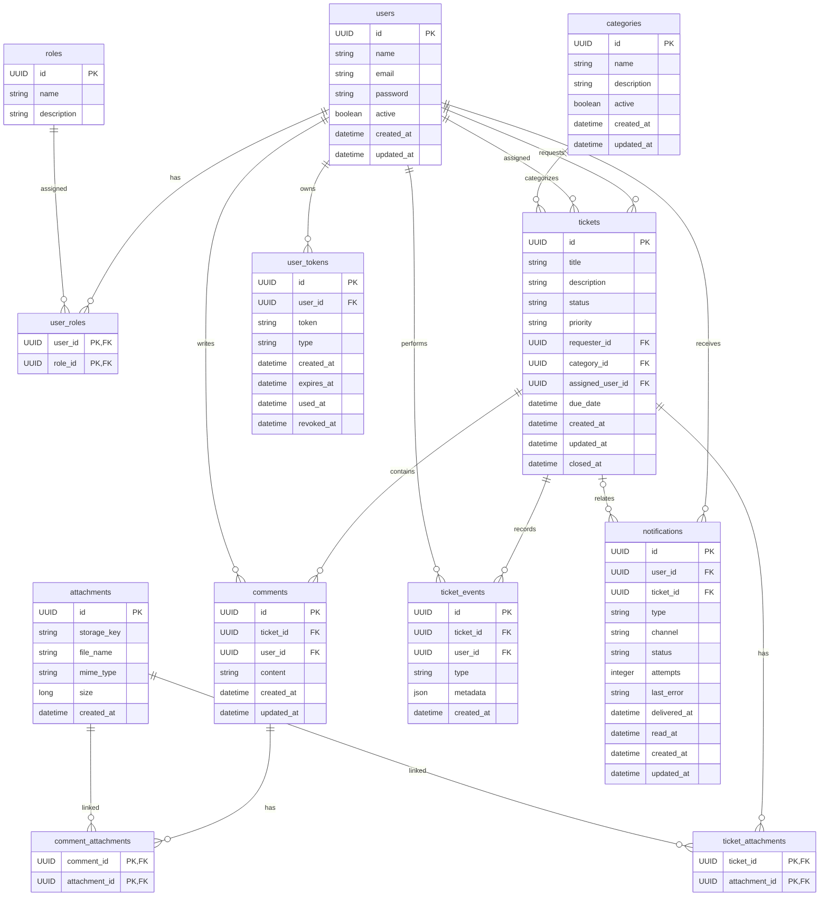

# Help Desk API

## Começar

### Pré-requisitos

- Docker e Docker Compose instalados.
- [Bun](https://bun.sh/) (v1.3+ ou superior) para executar testes e scripts locais:
  ```bash
  npm install -g bun
  ```
- Arquivo `.env` configurado a partir do `.env.example`.

### Inicialização

1. Copie o arquivo `.env.example` para `.env` e configure as credenciais do PostgreSQL e do administrador inicial. Para executar com Docker Compose, mantenha `DATABASE_HOST=postgres` e `DATABASE_PORT=5432`, que são o nome e a porta do PostgreSQL dentro da rede Docker. A variável `POSTGRES_EXPOSED_PORT` controla apenas a porta opcional publicada no host.

```bash
   cp .env.example .env
```

Se a API ou os scripts forem executados diretamente no host, use `DATABASE_HOST=localhost` e a porta definida em `POSTGRES_EXPOSED_PORT` em vez dos valores internos do Docker.

2. Inicie os serviços construindo as imagens:

```bash
   docker compose up -d --build
```

3. Acesse a API em `http://localhost:3000`. O endpoint de verificação de saúde está disponível em `/health`.

## Documentação dos Endpoints (Swagger)

A especificação completa de todos os endpoints da API (métodos HTTP, caminhos, parâmetros obrigatórios/opcionais, permissões de acesso, schemas de entrada e exemplos de resposta) está documentada interativamente via **Swagger UI**.

- **URL de acesso:** [http://localhost:3000/docs](http://localhost:3000/docs)
- **Arquivo de especificação OpenAPI:** localizado em [`docs/openapi.yaml`](docs/openapi.yaml)

### Collection do Postman

A collection para avaliação está em [`postman/helpdesk-api.postman_collection.json`](postman/helpdesk-api.postman_collection.json).

Para utilizá-la:

1. Inicie a API e importe o arquivo no Postman (`Import > File`).
2. Na collection, ajuste `baseUrl` caso a API não esteja em `http://localhost:3000`.
3. Configure `email` e `password` com as credenciais do administrador definidas no `.env`.
4. Execute `Health` e depois `Login`; o script do login armazena automaticamente o JWT em `access_token`.
5. Preencha `categoryId`, `ticketId`, `commentId`, `userId`, `notificationId` e `attachmentId` com os IDs retornados pelas requisições. Para uploads, abra a requisição correspondente, acesse `Body > form-data` e selecione o arquivo diretamente no campo `file`. O token de recuperação deve ser preenchido em `resetToken` a partir do e-mail recebido.

As requisições estão agrupadas por recurso e cobrem todos os endpoints publicados pela API, inclusive autenticação, recuperação de senha, upload de anexos e execução do job de notificações. Os scripts da collection preenchem automaticamente os IDs de usuário, categoria, chamado, comentário e anexo após as operações de criação; `notificationId` e `resetToken` devem ser informados quando necessários.

### Testes e Verificação de Qualidade

- **Executar testes unitários e de integração:**
  ```bash
  bun run test
  ```
- **Executar testes com verificação de cobertura (mínimo 70%):**
  ```bash
  bun run test:coverage
  ```
- **Executar verificação de lint (ESLint):**
  ```bash
  bun run lint
  ```

O projeto usa o Lefthook para executar automaticamente o lint e os testes com
cobertura mínima de 70% antes de cada commit. O hook é instalado pelo script
`prepare` durante a instalação das dependências. Para reinstalá-lo manualmente:

```bash
bun run prepare
```

### Infraestrutura e CI/CD

As decisões de infraestrutura, o fluxo de CI/CD, a estratégia de branches,
as verificações de segurança e as instruções de configuração dos serviços
externos estão documentados no
[README-INFRA.md](README-INFRA.md).

### Inicialização do banco de dados

O Docker Compose inicia o PostgreSQL 18, aplica as migrations pendentes e executa o seed inicial definido em `prisma/seed.js`.

O seed centraliza a execução de rotinas independentes para criação dos papéis, categorias e usuário administrador. Esses scripts são escritos em JavaScript, versionados no Git e idempotentes, podendo ser executados novamente sem duplicar os registros previstos.

## Sobre o projeto

O **Help Desk API** é uma API REST para gerenciamento de chamados de suporte de TI.

O sistema permite que usuários previamente cadastrados pela administração registrem chamados, acompanhem seu andamento, adicionem comentários e anexos, enquanto usuários com permissões administrativas ou de atendimento podem gerenciar categorias, atribuir responsáveis e atualizar informações dos chamados.

## Objetivo

O objetivo do sistema é centralizar o atendimento de solicitações de suporte de TI, permitindo:

- abertura e acompanhamento de chamados;
- classificação por categoria e prioridade;
- atribuição de responsáveis;
- atualização do status dos chamados;
- comunicação por meio de comentários;
- inclusão de arquivos e anexos;
- registro do histórico de alterações;
- notificações relacionadas aos chamados;
- controle de acesso por perfis;
- ativação de usuários e definição inicial de senha por e-mail;
- recuperação de senha por e-mail.

## Escopo

O sistema terá como entidade central o **Ticket (chamado)**.

A partir dele, outras entidades estarão relacionadas para representar o processo de atendimento:

- usuários que solicitam ou atendem chamados;
- categorias utilizadas para classificar os chamados;
- comentários realizados durante o atendimento;
- anexos relacionados a chamados e comentários;
- eventos que registram ações relevantes realizadas nos chamados;
- tokens utilizados nos processos de ativação de usuários, definição inicial de senha e recuperação de senha.

O modelo inclui notificações associadas a usuários e chamados. A aplicação entrega notificações internas e processa notificações por e-mail em segundo plano por SMTP, com retentativas configuráveis.

## Perfis de usuário

### Usuário comum

Pode:

- autenticar-se no sistema;
- criar chamados;
- visualizar seus próprios chamados;
- acompanhar o andamento dos chamados;
- adicionar comentários;
- adicionar anexos;
- atualizar informações permitidas de seus chamados;
- definir a senha inicial por meio do convite enviado pelo sistema;
- utilizar o processo de recuperação de senha.

### Agente

Representa um usuário autorizado a atuar no atendimento dos chamados.

Pode, conforme as regras de autorização definidas:

- visualizar chamados destinados ao atendimento;
- assumir ou receber chamados;
- alterar status;
- alterar prioridade;
- adicionar comentários;
- adicionar anexos;
- acompanhar o histórico dos chamados.

### Administrador

Possui permissões administrativas adicionais, como:

- gerenciar usuários;
- ativar ou desativar usuários;
- gerenciar categorias;
- administrar chamados;
- atribuir responsáveis;
- consultar informações administrativas;
- executar operações restritas aos administradores.

Um mesmo usuário poderá possuir mais de um papel.

## Entidades

### User

Representa os usuários do sistema.

Principais atributos:

- `id` — UUID
- `name`
- `email`
- `password` — nullable enquanto o usuário aguarda definir a senha; quando definida, é armazenada com hash Argon2id
- `active`
- `createdAt`
- `updatedAt`

Usuários desativados não poderão realizar autenticação, mas seus registros serão mantidos para preservar o histórico do sistema. Um usuário recém-criado pode estar ativo administrativamente mesmo sem senha; sem senha configurada, ele ainda não pode autenticar.

Não haverá cadastro público de usuários. Novos usuários serão criados por administradores e receberão um token temporário por e-mail para definir a senha inicial.

O primeiro administrador será criado por meio de um seed durante a inicialização do ambiente.

### Role

Representa um papel de acesso do sistema.

Principais atributos:

- `id` — UUID
- `name`
- `description`

Papéis inicialmente previstos:

- `USER`
- `AGENT`
- `ADMIN`

### UserRole

Tabela de relacionamento entre usuários e papéis.

Atributos:

- `userId` — UUID
- `roleId` — UUID

A combinação `userId + roleId` deverá ser única.

### Ticket

Representa um chamado de suporte.

Principais atributos:

- `id` — UUID
- `title`
- `description`
- `status` — `OPEN`, `IN_PROGRESS`, `WAITING_USER`, `RESOLVED` ou `CLOSED`
- `priority` — `LOW`, `MEDIUM`, `HIGH` ou `CRITICAL`
- `requesterId` — usuário solicitante
- `categoryId`
- `assignedUserId` — responsável pelo atendimento, quando houver
- `dueDate` — prazo previsto para atendimento
- `createdAt`
- `updatedAt`
- `closedAt`

Status inicialmente previstos:

- `OPEN`
- `IN_PROGRESS`
- `WAITING_USER`
- `RESOLVED`
- `CLOSED`

Prioridades inicialmente previstas:

- `LOW`
- `MEDIUM`
- `HIGH`
- `CRITICAL`

### Category

Representa a categoria de um chamado.

Principais atributos:

- `id` — UUID
- `name`
- `description`
- `active`
- `createdAt`
- `updatedAt`

Categorias inativas não deverão ser utilizadas na abertura de novos chamados.

### Comment

Representa uma mensagem adicionada a um chamado.

Principais atributos:

- `id` — UUID
- `ticketId`
- `userId`
- `content`
- `createdAt`
- `updatedAt`

### Attachment

Representa um arquivo armazenado pelo sistema.

Principais atributos:

- `id` — UUID
- `storageKey`
- `fileName`
- `mimeType`
- `size` — tamanho em bytes
- `createdAt`

### TicketAttachment

Relaciona arquivos aos chamados.

Atributos:

- `ticketId` — UUID
- `attachmentId` — UUID

### CommentAttachment

Relaciona arquivos aos comentários.

Atributos:

- `commentId` — UUID
- `attachmentId` — UUID

### TicketEvent

Representa eventos relevantes ocorridos em um chamado.

Principais atributos:

- `id` — UUID
- `ticketId` — UUID
- `userId` — UUID
- `type`
- `metadata`
- `createdAt`

Tipos inicialmente previstos:

- `CREATED`
- `STATUS_CHANGED`
- `PRIORITY_CHANGED`
- `ASSIGNED`
- `UNASSIGNED`
- `COMMENT_ADDED`
- `ATTACHMENT_ADDED`
- `CATEGORY_CHANGED`
- `DUE_DATE_CHANGED`

O histórico deverá registrar ações relevantes para acompanhamento do chamado, não simplesmente qualquer alteração interna realizada no banco.

O campo `metadata` poderá armazenar informações complementares da alteração, como valor anterior e novo valor.

### UserToken

Representa tokens temporários relacionados a processos de segurança do usuário.

Principais atributos:

- `id` — UUID
- `userId` — UUID
- `token`
    Hash do token utilizado para ativação ou recuperação de senha.
- `type`
- `createdAt`
- `expiresAt`
- `usedAt`
- `revokedAt`

Tipos inicialmente previstos:

- `PASSWORD_SETUP` — utilizado para ativação do usuário e definição da senha inicial;
- `PASSWORD_RESET` — utilizado para recuperação/redefinição de senha.


Tokens de tipos diferentes possuem finalidades independentes. Para cada tipo, somente o token mais recente poderá permanecer válido.

### Notification

Representa uma notificação destinada a um usuário e a um canal. É diferente de `TicketEvent`: o evento registra o fato ocorrido; a notificação registra quem deve ser informado.

Principais atributos:

- `id` — UUID
- `userId` — destinatário
- `ticketId` — chamado relacionado, quando aplicável
- `type` — `TICKET_ASSIGNED`, `NEW_COMMENT`, `STATUS_CHANGED`, `PRIORITY_CHANGED`, `DUE_SOON` ou `OVERDUE`
- `channel` — `IN_APP` ou `EMAIL`
- `status` — `PENDING`, `PROCESSING`, `DELIVERED` ou `FAILED`
- `attempts` — quantidade de tentativas de entrega
- `lastError` — erro mais recente, quando houver
- `deliveredAt` — instante da entrega
- `readAt` — instante em que o usuário leu a notificação interna
- `createdAt` e `updatedAt`

Cada registro representa um destinatário e canal. Notificações internas aparecem na caixa do usuário; notificações por e-mail são processadas pelo worker em segundo plano. O conteúdo é montado pela aplicação quando necessário.

## Relacionamentos

- `User` N:N `Role`, através de `UserRole`.
- `User` 1:N `Ticket`, como solicitante.
- `User` 1:N `Ticket`, como responsável pelo atendimento.
- `Category` 1:N `Ticket`.
- `Ticket` 1:N `Comment`.
- `User` 1:N `Comment`.
- `Ticket` 1:N `TicketEvent`.
- `User` 1:N `TicketEvent`.
- `User` 1:N `Notification`.
- `Ticket` 1:N `Notification`.
- `Ticket` N:N `Attachment`, através de `TicketAttachment`.
- `Comment` N:N `Attachment`, através de `CommentAttachment`.
- `User` 1:N `UserToken`.

## Diagrama Entidade-Relacionamento



## Regras de negócio

1. Todo usuário deverá possuir pelo menos um papel de acesso.

2. Um usuário desativado não poderá realizar autenticação.

3. O e-mail do usuário deverá ser único.

4. Todo chamado deverá possuir título, descrição, categoria, prioridade e usuário solicitante.

5. Um chamado poderá não possuir responsável inicialmente.

6. O responsável por um chamado deverá ser um usuário autorizado a atuar no atendimento.

7. Categorias inativas não poderão ser utilizadas em novos chamados.

8. Todo comentário deverá estar associado a um chamado e a um usuário.

9. Arquivos poderão estar associados a chamados ou comentários.

10. Alterações relevantes nos chamados deverão gerar eventos no histórico.

11. Um chamado poderá possuir uma data limite de atendimento (`dueDate`).

12. Chamados encerrados deverão possuir registro de encerramento (`closedAt`).

13. Tokens deverão possuir prazo de validade.

14. Um token utilizado, expirado ou revogado não poderá ser reutilizado.

15. Para cada tipo de token, somente o token mais recente poderá permanecer válido. A emissão de um novo token do mesmo tipo deverá revogar o anterior.

16. `PASSWORD_SETUP` será utilizado no primeiro acesso para definição da senha inicial.
17. `PASSWORD_RESET` será utilizado para recuperação ou redefinição de senha. O mesmo fluxo de recuperação também pode ser utilizado por usuários que ainda não configuraram a senha inicial.

18. Senhas não deverão ser armazenadas em texto puro. O sistema deverá armazená-las utilizando um mecanismo seguro de hash de senha.

19. Tokens de ativação e recuperação deverão ser tratados como credenciais sensíveis e armazenados de forma segura, preferencialmente utilizando hash, de modo que o valor original não permaneça diretamente armazenado no banco de dados.

20. Novos usuários deverão ser cadastrados por um administrador; não haverá cadastro público de usuários.

21. O sistema deverá possuir um administrador inicial criado por meio de seed durante a inicialização do ambiente.

22. O administrador poderá criar usuários e definir seus papéis de acesso.

23. Usuários recém-criados deverão realizar a ativação e definição da senha inicial por meio de um token enviado por e-mail.

24. Usuários que não receberam ou perderam o token inicial deverão utilizar o fluxo de recuperação de senha para solicitar um novo token.

25. Operações administrativas deverão ser protegidas por autorização baseada no papel do usuário.

26. Usuários comuns somente poderão acessar e modificar recursos para os quais possuam autorização.

27. A API deverá retornar respostas HTTP coerentes com erros de validação, autenticação, autorização, conflito e recurso não encontrado.

28. Chamados encerrados deverão ter `closedAt`; a aplicação deverá preservar eventos de auditoria, sem exclusão em cascata dos registros históricos.

## Funcionalidades implementadas

### Autenticação e segurança

- Login com e-mail e senha.
- Autenticação utilizando JWT.
- Autorização baseada em papéis.
- Gerenciamento de usuários pelo administrador.
- Ativação de usuários e definição inicial de senha por e-mail.
- Recuperação/redefinição de senha por e-mail.
- Expiração e invalidação de tokens de ativação e recuperação.
- Recuperação de senha também aplicável ao primeiro acesso de usuários sem senha configurada.
- Proteção de informações sensíveis.

O sistema não terá cadastro público. O primeiro administrador será criado por meio de seed, e os demais usuários serão cadastrados pelos administradores.

### Chamados

- Criação de chamados.
- Consulta de chamados.
- Atualização de chamados.
- Alteração de status.
- Alteração de prioridade.
- Atribuição e remoção de responsável.
- Definição de prazo.
- Encerramento.
- Filtros, busca e paginação.

### Comentários

- Adição de comentários.
- Consulta de comentários de um chamado.
- Associação de anexos.

### Anexos

- Upload de arquivos.
- Associação de arquivos a chamados e comentários.
- Armazenamento utilizando serviço externo.

### Histórico

- Registro de eventos relevantes.
- Consulta do histórico de um chamado.
- Registro do usuário responsável por cada ação.

### Notificações

O modelo utiliza a entidade `Notification` para representar notificações destinadas aos usuários.

A ideia é diferenciar:

- **TicketEvent:** registra o que aconteceu no chamado.
- **Notification:** informa um usuário de que algo relevante aconteceu.

Possíveis notificações:

- chamado atribuído;
- novo comentário;
- alteração de status;
- alteração de prioridade;
- chamado próximo do vencimento;
- chamado atrasado.

Cada notificação pertence a um destinatário e canal. A caixa interna e o processamento de e-mails compartilham o registro, mas mantêm estado de leitura separado do estado de entrega.

## Operações de domínio e exceções ao CRUD

As operações abaixo não possuem exclusão física porque os registros participam do histórico do atendimento:

- **Usuários:** são desativados com `PATCH /users/{id}/active`. O registro é preservado porque pode ser solicitante, responsável, autor de comentário ou autor de evento de auditoria.
- **Categorias:** podem ser desativadas com `PUT /categories/{id}`. A exclusão física poderia quebrar a classificação dos chamados existentes.
- **Chamados:** não são excluídos depois de criados. O atendimento é encerrado com `PATCH /tickets/{id}/status`, preservando seus eventos, comentários e vínculos.
- **Comentários:** são imutáveis após a criação porque representam a comunicação registrada no chamado. Para corrigir ou complementar uma informação, o usuário deve publicar um novo comentário.
- **Eventos de auditoria:** são preservados e não possuem exclusão.
- **Notificações:** não são excluídas; podem ser marcadas como lidas individualmente ou em lote por meio de `PATCH /notifications/{id}/read` e `PATCH /notifications/read-all`.

Os anexos são a exceção: possuem exclusão própria em `DELETE /attachments/{id}`, condicionada à autorização do usuário e ao estado do chamado. As demais entidades possuem criação, consulta e atualização quando essas operações fazem sentido para o domínio.

## API externa

O projeto utiliza o **Cloudinary** como serviço externo de armazenamento e gerenciamento dos arquivos enviados como anexos em chamados e comentários.

Nesse cenário, o sistema é responsável por controlar os metadados e relacionamentos dos anexos (persisti-los via Prisma no PostgreSQL), enquanto o upload seguro, processamento e entrega de mídia são delegados à API do Cloudinary.

### Configuração do Cloudinary

1. Crie uma conta no [Cloudinary](https://cloudinary.com/) e acesse o **Dashboard**.
2. Copie os valores `Cloud name`, `API Key` e `API Secret` para `CLOUDINARY_CLOUD_NAME`, `CLOUDINARY_API_KEY` e `CLOUDINARY_API_SECRET`.
3. Mantenha `CLOUDINARY_FOLDER` com o diretório lógico desejado. Não é necessário criar manualmente um upload preset: a aplicação utiliza upload assinado pela API.
4. Configure `MAX_FILE_SIZE_MB` conforme o limite de arquivos desejado e valide o fluxo usando as requisições de upload da collection.

### Configuração do SMTP

O SMTP é necessário para recuperação de senha, definição da senha inicial de novos usuários e notificações por e-mail.

1. Configure uma conta SMTP de teste ou de uso da aplicação.
2. Preencha `SMTP_HOST`, `SMTP_PORT`, `SMTP_USER`, `SMTP_PASS`, `SMTP_SECURE` e `MAIL_FROM` no `.env`.
3. Ao utilizar Gmail, prefira uma senha de aplicativo em vez da senha principal da conta.
4. Para testar o envio de notificações pendentes, utilize `POST /notifications/trigger-job` com um token de administrador. O scheduler também executa o processamento conforme `NOTIFICATION_CRON_SCHEDULE`.

## Tecnologias

- Node.js & Bun
- Express
- PostgreSQL & Prisma ORM
- Docker
- JWT & Argon2
- Cloudinary (API externa para armazenamento de arquivos e anexos)
- Nodemailer & Handlebars (templates de e-mail)
- node-schedule (processamento em segundo plano e retentativas)
- Vitest & Supertest
- Swagger/OpenAPI
- Postman

A arquitetura é estruturada seguindo princípios de **Clean Architecture**, com separação estrita de regras de negócio, casos de uso, apresentação HTTP, persistência e integrações externas.

## Identificadores

As entidades do sistema utilizam **UUIDs** como identificadores padronizados.

## Status do projeto

**Operações de domínio e integração funcional concluídas**

- Operações de criação, consulta e atualização disponíveis conforme as regras de negócio; exclusões físicas são restritas aos anexos.
- Integração funcional com o Cloudinary para upload e deleção de anexos.
- Notificações internas (`IN_APP`) com controle de leitura e notificações por e-mail (`EMAIL`) com worker em segundo plano, retentativa automática configurável (máximo de 10 tentativas) e templates Handlebars.
